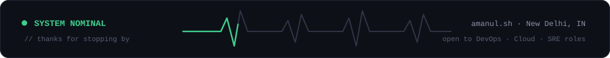

<div align="center">



<br/>

[](https://www.linkedin.com/in/amanul-hasan-9a204a2b5)
[](mailto:amanulmat@gmail.com)
[](https://YOUR-PORTFOLIO-URL)

</div>

<br/>

## `$ whoami`

<div align="center">

</div>

<br/>

## `cat about.env`

```ini
# about.env
ROLE       = "DevOps Intern @ NEC Corporation India"
FOCUS      = "Kubernetes · OpenShift · CI/CD · DevSecOps"
IMPACT     = "MTTR reduced 15% via faster root-cause analysis"
PREVIOUSLY = "DevOps Intern @ Zn Softech"
EDUCATION  = "B.Tech IT '26 · BPIT, Delhi"
LOCATION   = "New Delhi, India"
STATUS     = open_to_work=true
```

<br/>

## How I ship

<div align="center">

</div>

<br/>

## Toolchain

<div align="center">

</div>

<br/>

## Featured projects

<table>
<tr>
<td width="50%" valign="top">

### End-to-End DevSecOps Implementation
Automated pipeline that treats security as a first-class stage: CI/CD, image scanning, GitOps deployment and monitoring wired end to end.

`Terraform` `ArgoCD` `Trivy` `Prometheus` `Grafana` `GitHub Actions`

**[View repository →](https://github.com/iamamanul/REPLACE-WITH-REPO-NAME)**

</td>
<td width="50%" valign="top">

### Static Site Deployment on AWS
Terraform provisions an S3-hosted site and GitHub Actions runs `init → validate → plan → apply` on every commit.

`Terraform` `AWS S3` `GitHub Actions` `CI/CD`

**[View repository →](https://github.com/iamamanul/REPLACE-WITH-REPO-NAME)**

</td>
</tr>
</table>

<br/>

## GitHub activity

<div align="center">


<br/><br/>

<picture>
  <source media="(prefers-color-scheme: dark)" srcset="https://raw.githubusercontent.com/iamamanul/iamamanul/output/github-snake-dark.svg" />
  <source media="(prefers-color-scheme: light)" srcset="https://raw.githubusercontent.com/iamamanul/iamamanul/output/github-snake.svg" />
  
</picture>

</div>

<br/>

<div align="center">

</div>
